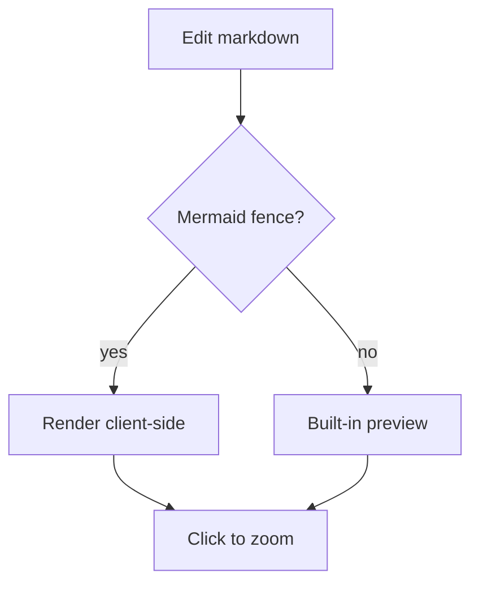
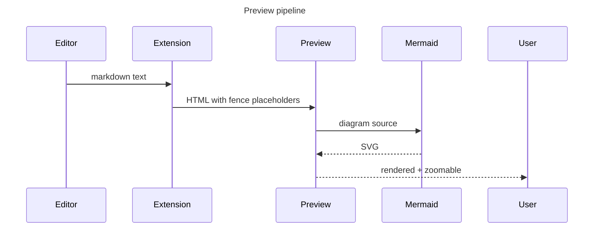
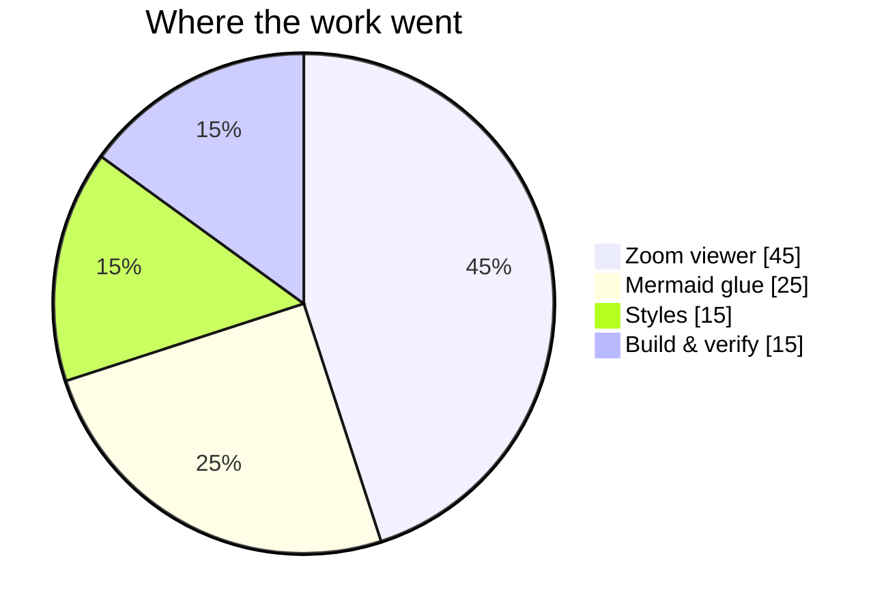

# Markdown Vista — demo

Open the preview (`Cmd/Ctrl+Shift+V`) and click any graphic below.

## Mermaid







A broken diagram stays an ordinary code block instead of blanking the document:

```mermaid
this is not valid mermaid
```

## Math (rendered by VS Code itself, zoomable by this extension)

Inline: $E = mc^2$

$$
\int_{-\infty}^{\infty} e^{-x^2}\,dx = \sqrt{\pi}
$$

## Extended syntax

==Highlighted==, ++inserted++, H~2~O, x^2^, :tada: :rocket:

Term
:   A definition list entry.

Another term
:   With its own definition.

*[CSP]: Content Security Policy

The CSP is why PNG export needs a fallback.[^1]

[^1]: A preview script has no message channel back to the extension host.

## Task lists and code (built-in)

- [x] Uses the built-in preview
- [ ] Rebuilds what VS Code already ships

```ts
export function activate() {
  return { extendMarkdownIt: (md) => applyMarkdownVistaPlugins(md) }
}
```
